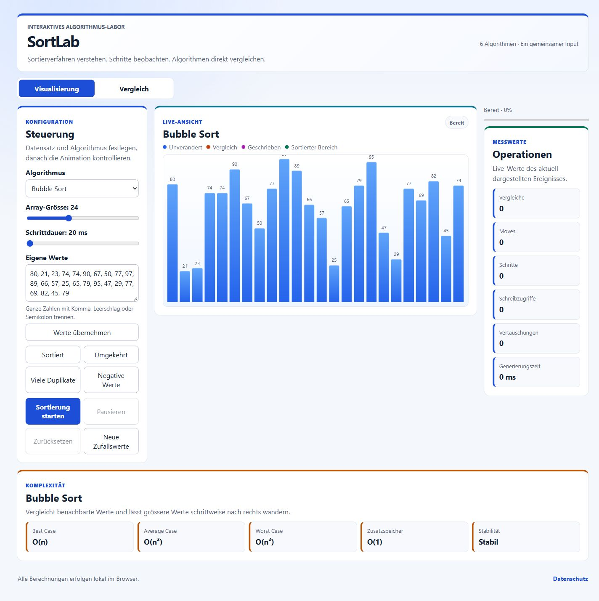

# SortLab

**Deutsch** | [English](./README_EN.md) | [Live-Demo](https://alekszyro.github.io/SortLab/)

SortLab ist ein interaktives Labor für Sortieralgorithmen. Die React-Anwendung visualisiert einzelne Algorithmusereignisse, misst Vergleiche und Array-Schreibzugriffe und stellt zwei Verfahren mit demselben Eingabedatensatz gegenüber.



Wähle ein Beispiel oder gib bis zu 64 Ganzzahlen zwischen −99 und 99 ein. Du kannst die Animation pausieren, fortsetzen oder zwei Verfahren auf derselben Eingabe vergleichen. Pro Takt rückt jede Seite um ein aufgezeichnetes Ereignis vor.

## Algorithmen

| Algorithmus    | Best Case  | Average Case | Worst Case | Zusatzspeicher     | Stabil |
| -------------- | ---------- | ------------ | ---------- | ------------------ | ------ |
| Bubble Sort    | O(n)       | O(n²)        | O(n²)      | O(1)               | Ja     |
| Selection Sort | O(n²)      | O(n²)        | O(n²)      | O(1)               | Nein   |
| Insertion Sort | O(n)       | O(n²)        | O(n²)      | O(1)               | Ja     |
| Merge Sort     | O(n log n) | O(n log n)   | O(n log n) | O(n)               | Ja     |
| Quick Sort     | O(n log n) | O(n log n)   | O(n²)      | O(log n) im Mittel | Nein   |
| Heap Sort      | O(n)       | O(n log n)   | O(n log n) | O(1)               | Nein   |

Eine Vertauschung zählt als zwei Schreibzugriffe ins Arbeitsarray. Die Tabelle beschreibt das Sortierverfahren selbst. Die Animation speichert zusätzlich Momentaufnahmen. Bei lauter gleichen Werten endet jede Heap-Reparatur bereits an der Wurzel. Quick Sort verwendet den letzten Wert als Pivot und kann bei sortierten Daten O(n) Stack-Speicher benötigen. Die Zeitmessung umfasst die Instrumentierung und hängt von Browser und Gerät ab.

## Lokal starten

Node.js 22.13+ oder 24.

```sh
npm ci
npm run dev
```

`npm run check` führt Prettier, ESLint, Vitest und den Vite-Build aus.

[Benutzeranleitung](BENUTZERANLEITUNG.md) · [Portfolio](https://aleksandar-nikolic.ch/) · [MIT](LICENSE)
